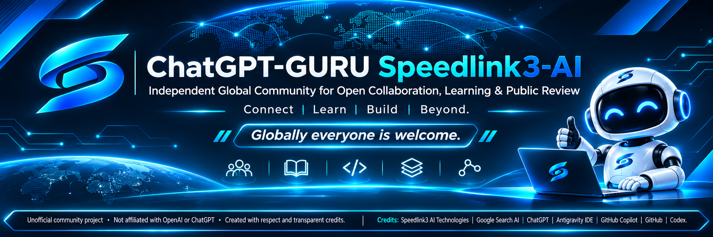

<div align="center">



# Welcome to ChatGPT-GURU Speedlink3-AI

**An Independent Global Community for Open Collaboration, Learning & Public Review**

**Everyone is welcome, from beginners to experienced developers.**

</div>

This collaborative initiative was founded and is independently operated by **Speedlink3 AI Technologies**, led by Shahbaz Hossain.

Our aim is to explore how human ideas, AI-assisted analysis, development tools, independent researchers and open-source contributors can work together to create useful, secure and verifiable software.

## Our Story

The initiative began with a real content-quality problem on [speedlink3.net](https://speedlink3.net). After reviewing information from Google Search AI, the founder discussed the issue with **ChatGPT Guru**, and that collaboration led to the idea of building **Speedlink3 Content Guardian**, a WordPress plugin.

This GitHub organization supports transparent public development, evidence-based review and participation by people worldwide. Development and research tools are collaborators, not competitors. Failures, fixes and testing history are part of the learning process.

No public release is claimed until source publication and test evidence are independently verified.

## Community Values

- Human Vision
- Open Collaboration
- Transparent Attribution
- Evidence-Based Development
- Security and Privacy
- Respectful Global Participation

## How We Work

```text
IDEA → ANALYSIS → IMPLEMENTATION → LOCAL TESTING → CI VALIDATION → HUMAN REVIEW → OWNER APPROVAL → PUBLIC RELEASE
```

Decisions should be supported by reproducible technical evidence, independent review and clear human accountability.

## Community Roles

| Role | Community description |
|---|---|
| Founder & Project Owner | Speedlink3 AI Technologies |
| Technical Analysis & Suggestions | ChatGPT Guru and Google Search AI, according to documented contributions |
| Development Workers | Antigravity IDE, GitHub Copilot and Codex, according to documented contributions |
| Public Collaboration Platform | GitHub |
| Global Community | Developers, testers, security researchers, writers, designers, translators and contributors worldwide |

Tool involvement does not imply formal endorsement or institutional partnership.

## Our Projects

**Speedlink3 Content Guardian** is an evolving, manual-only, password-gated WordPress content-auditing initiative.

It is not presented here as publicly released unless a repository is later approved and published. Private repositories and plugin source are not exposed through this community profile.

Future public projects may be added after owner approval.

**Global repository rule:** All public **MIT-licensed** repositories in this organization follow the same CGS3 AI community governance once onboarded. **Every private repository is categorically excluded from public community automation — without exception.** [Read the privacy and repository scope policy](https://github.com/ChatGPT-GURU-Speedlink3-AI/.github/blob/main/docs/REPOSITORY-PRIVACY-SCOPE.md).

## Join Our Community

You are invited to:

- Share useful ideas.
- Contribute code and documentation.
- Report bugs responsibly.
- Review security and technical evidence.
- Improve accessibility and quality.
- Learn collaboratively and respectfully.

**Ready to contribute?** [Join as a volunteer](https://github.com/ChatGPT-GURU-Speedlink3-AI/.github/issues/new?template=community-volunteer.yml) · [View the open community invitation](https://github.com/ChatGPT-GURU-Speedlink3-AI/.github/issues/2) · [Review current technical issues](https://github.com/ChatGPT-GURU-Speedlink3-AI/.github/issues) · [Read the community coordination policy](https://github.com/ChatGPT-GURU-Speedlink3-AI/.github/blob/main/docs/COMMUNITY-AUTOMATION-V1.md).

No experience threshold, public contact details, or formal affiliation is required. Community participation is voluntary and does not automatically grant source or production write access.

Please follow the public repository's issue templates, contribution guidance and code of conduct where those resources exist.

## Credits

**Speedlink3 AI Technologies | Google Search AI | ChatGPT | Antigravity IDE | GitHub Copilot | GitHub | Codex**

These names acknowledge assistance, tools or platforms. They do not imply sponsorship or official endorsement.

## Founder Message

> "Here, we are not competing to defeat one another. We are exploring how people, AI-assisted tools and a global development community can work together, learn from mistakes and build something useful.
>
> Everyone who contributes constructively is part of our community family."

**- Shahbaz Hossain**
Founder, Developer & CEO
Speedlink3 AI Technologies

---

<div align="center">

**Connect | Learn | Build | Beyond.**

*Independent community · Open learning · Transparent collaboration.*

**Independent community project. Not affiliated with, sponsored by or endorsed by OpenAI, Google, Microsoft, GitHub or the providers of referenced AI tools.**

</div>
